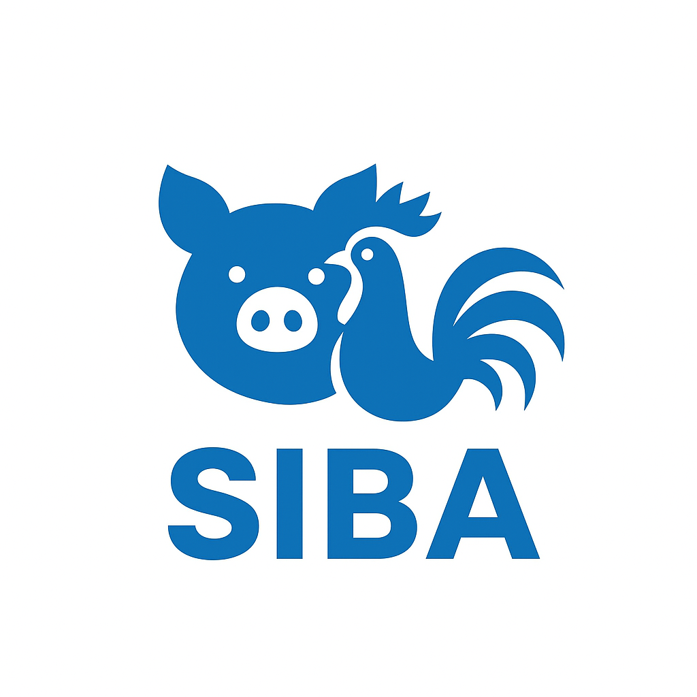
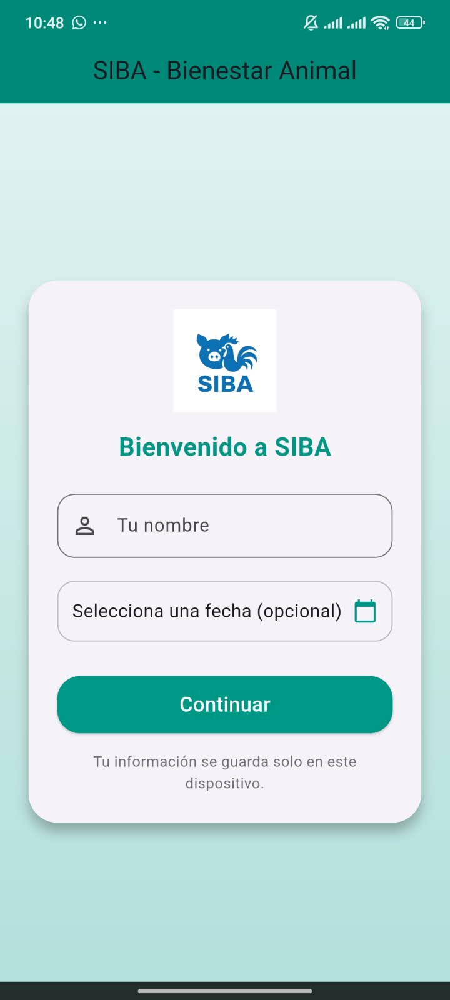
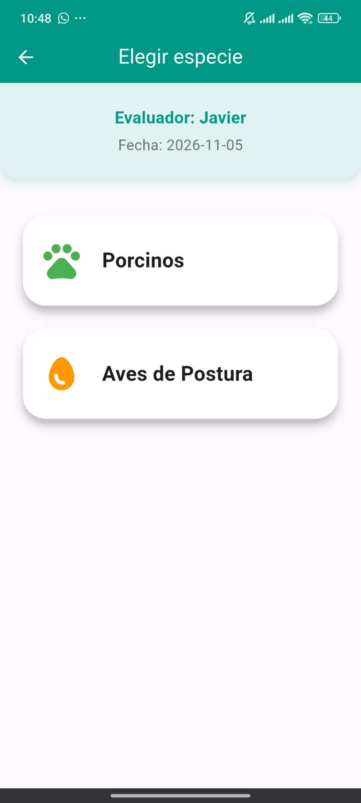
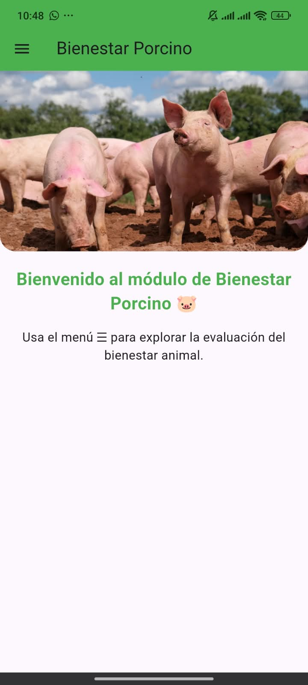
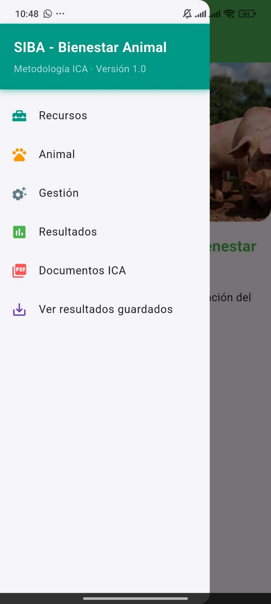
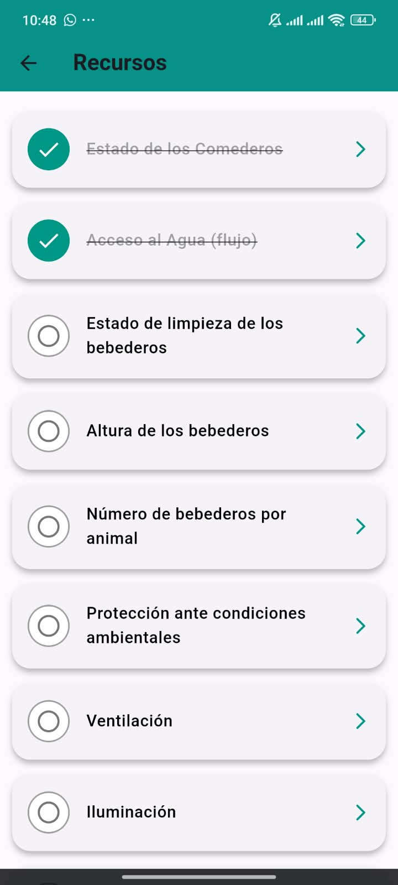
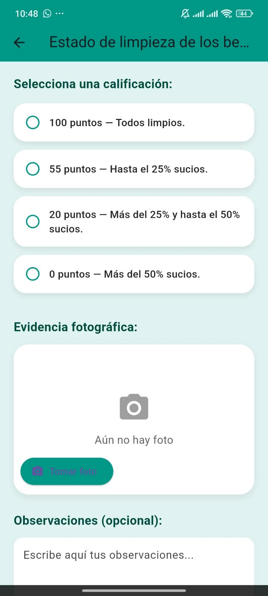
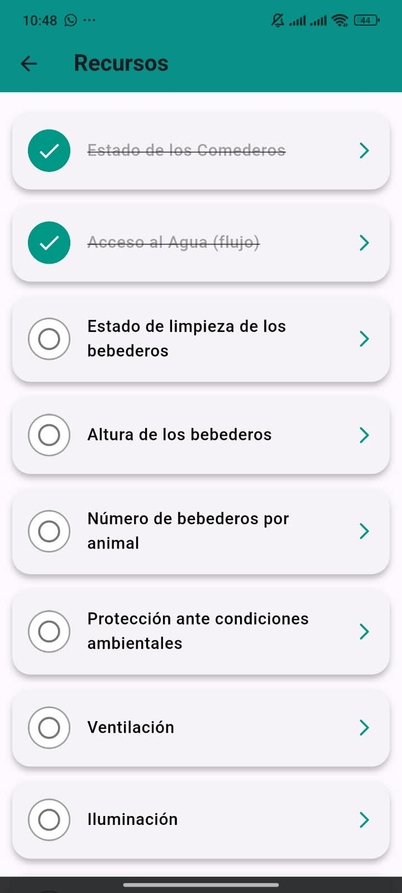
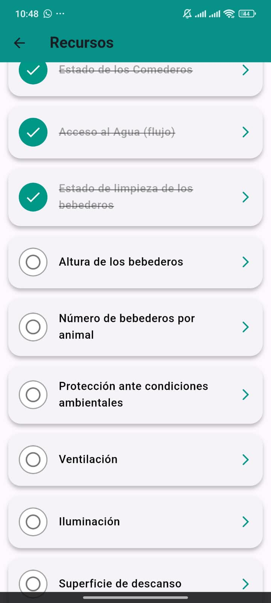
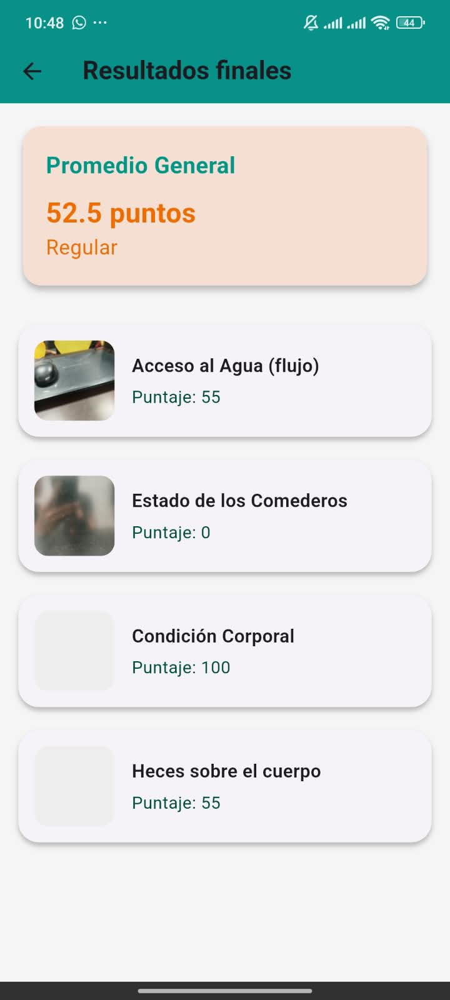

<p align="center">
  
</p>

<h1 align="center">SIBA · Sistema de Información de Bienestar Animal</h1>

<p align="center">
  <strong>Plataforma Digital de Auditoría Zootécnica y Monitoreo Normativo en Granja</strong><br>
  <em>Granja Experimental — Universidad Francisco de Paula Santander Ocaña (UFPSO)</em><br>
  Resolución 136 de 2020 (Porcinos) · Resolución 253 de 2020 (Aves de Postura) · Metodología EBA ICA 3.0
</p>

<p align="center">
  <a href="https://app-bienestar-animal.vercel.app"></a>
  <a href="https://supabase.com"></a>
  <a href="https://flutter.dev"></a>
  
  
</p>

---

## 📖 1. Descripción del Proyecto

**SIBA** es una solución tecnológica integral de ingeniería y zootecnia desarrollada para digitalizar, estandarizar y automatizar los procesos de evaluación de bienestar animal en la **Granja Experimental de la Universidad Francisco de Paula Santander Ocaña (UFPSO)**.

Tradicionalmente, las auditorías pecuarias se realizaban mediante planillas físicas de papel, generando demoras en la consolidación de datos, riesgo de pérdida de evidencia fotográfica y retrasos en la toma de decisiones sanitarias. SIBA resuelve esta problemática implementando una **arquitectura tolerante a desconexión (Offline-First)** que permite a los evaluadores calificar los indicadores normativos en medio de corrales y galpones sin cobertura de internet, capturar evidencia fotográfica in situ y sincronizar automáticamente las auditorías hacia la nube de **Supabase** y el **Panel Web de Administración en Vercel** en cuanto el dispositivo detecta conectividad Wi-Fi o datos celulares.

---

## 🏛️ 2. Marco Normativo Oficial Colombiano

La plataforma implementa rigurosamente los manuales y rúbricas establecidos por el **Ministerio de Agricultura y Desarrollo Rural (MADR)** y el **Instituto Colombiano Agropecuario (ICA)**:

```
┌─────────────────────────────────────────────────────────────────────────────┐
│                            MARCO NORMATIVO SIBA                             │
├──────────────────────────────────────┬──────────────────────────────────────┤
│ 🐷 LÍNEA PORCINA                     │ 🐔 LÍNEA AVES DE POSTURA             │
│ • Resolución 136 de 2020 (MADR)      │ • Resolución 253 de 2020 (MADR)      │
│ • Metodología EBA Porcinos 3.0 (ICA) │ • Cartilla Técnica Fenavi & ICA      │
│ • 37 Indicadores Normativos          │ • 25 Indicadores Normativos          │
│ • Rúbricas (100, 55, 20, 0 puntos)   │ • Evaluación en Piso y Pastoreo      │
└──────────────────────────────────────┴──────────────────────────────────────┘
```

Cada indicador evalúa uno de los **tres pilares zootécnicos universales**:
1. **Recursos y Alojamiento:** Calidad de comederos, bebederos, caudal hídrico, confort térmico, ventilación, calidad de cama y espacio vital.
2. **Salud y Condición Animal:** Condición corporal, integridad de plumaje, lesiones, cojeras, jadeo, temblores y amontonamiento.
3. **Gestión y Bioseguridad:** Planes sanitarios documentados, registros de mortalidad, capacitación del personal y buenas prácticas de uso de medicamentos veterinarios.

---

## 👥 3. Equipo de Investigación y Créditos Institucionales

* **Universidad:** Universidad Francisco de Paula Santander Ocaña (UFPSO)
* **Facultad:** Facultad de Ingenierías · División de Zootecnia
* **Grupo de Investigación:** GRIITEM (Grupo de Investigación en Informática y Telecomunicaciones)
* **Ubicación de Aplicación:** Granja Experimental UFPSO, Vereda El Algodonal, Ocaña, Norte de Santander, Colombia.

### Investigadores Principales:
* 🎓 **Javier Mauricio Serna Osorio** — Código Estudiantil: `0192546`
* 🎓 **Juan Manuel Garrido Amaya** — Código Estudiantil: `0192544`

---

## 📱 4. Acceso en Vivo y Modos de Uso

| Plataforma | Tipo | Enlace / Ubicación | Características |
|---|---|---|---|
| **PWA Web Móvil (iPhone / Android)** | Aplicación Web Progresiva | [app-bienestar-animal.vercel.app](https://app-bienestar-animal.vercel.app) | Instalable en iPhone Safari vía *"Añadir a pantalla de inicio"*, funciona offline, cámara móvil y rúbricas. |
| **Panel Central Web (Dashboard)** | Panel de Auditorías | [app-bienestar-animal.vercel.app](https://app-bienestar-animal.vercel.app) *(Pestaña Panel Admin)* | Monitoreo en vivo, KPIs generales, filtrado por corral y exportación a Excel (.xlsx). |
| **App Android Nativa** | Archivo APK Release | `SIBA_App_Bienestar_Animal.apk` | Empaquetado oficial con base de datos SQLite local y auto-sincronización en segundo plano. |

---

## 📸 5. Galería de Interfaces y Capturas del Sistema

<div align="center">

### 📱 Flujo de Evaluación en Campo (Móvil Android / iOS PWA)

| 1. Ingreso del Evaluador | 2. Líneas de Producción | 3. Categorías de Auditoría |
|:---:|:---:|:---:|
|  |  |  |
| *Identificación con nombre oficial y fecha* | *Selección editorial: Porcinos o Aves* | *Los 3 pilares con barra de avance* |

| 4. Lista de Indicadores | 5. Rúbricas y Fotografía | 6. Dictamen IGBA y Resultados |
|:---:|:---:|:---:|
|  |  |  |
| *Avance en tiempo real por categoría* | *Rúbricas oficiales (100, 55, 20, 0 pts) y cámara* | *Semáforo zootécnico y dictamen ICA* |

| 7. Menú Lateral (Drawer) | 8. Normativa en Línea | 9. Detalle Técnico de Indicador |
|:---:|:---:|:---:|
|  |  |  |
| *Navegación fluida y cierre seguro* | *Acceso a PDFs oficiales MinAg / ICA* | *Evidencias fotográficas in situ* |

</div>

---

## 🏗️ 6. Arquitectura del Sistema (Offline-First)

```mermaid
flowchart TD
    subgraph Campo["🌾 Corrales y Galpones (Sin Señal)"]
        A["📱 Celular Evaluador (Android / iPhone)"] -->|"Califica rúbricas e inserta fotos"| B["💾 SQLite Local / LocalStorage"]
        B -->|"Calcula IGBA preliminar"| C["📊 Semáforo Zootécnico Local"]
    end

    subgraph Deteccion["📶 Detección de Conectividad"]
        B -->|"Connectivity Listener / Online Event"| D{"¿Hay Internet?"}
        D -- "NO" -->|"Resguarda datos seguros"| B
        D -- "SÍ" -->|"Agrupa sesión en 1 Ficha Consolidada"| E["🚀 SupabaseSyncService (REST / JWT)"]
    end

    subgraph Nube["☁️ Nube Central SIBA-UFPSO"]
        E -->|"HTTP 201 Insert JSONB"| F[("🐘 Supabase PostgreSQL Cloud")]
        F -->|"Polling automático cada 12s"| G["💻 Panel Web Vercel (siba-admin-web)"]
        G -->|"Descarga instantánea"| H["📑 Sábana Oficial Excel (.xlsx)"]
    end
```

---

## 🧮 7. Modelo de Cálculo del Índice Global (IGBA)

El puntaje del **Índice Global de Bienestar Animal (IGBA)** se consolida automáticamente calculando el promedio ponderado de los indicadores registrados durante la sesión:

$$\text{IGBA} = \frac{\sum_{i=1}^{n} \text{Puntaje Indicador}_i}{n}$$

### Escala de Calificación Zootécnica Oficial:

| Rango de Puntaje | Nivel de Bienestar | Color Institucional | Dictamen Sanitario |
|---|---|---|---|
| **80.0 — 100 pts** | **Excelente** | 🟢 Verde Bosque (`#263F30`) | Cumplimiento sobresaliente de la Resolución 136 / 253. Condiciones óptimas de confort. |
| **60.0 — 79.9 pts** | **Bueno** | 🟡 Verde Oliva (`#5B6B1E`) | Cumplimiento técnico aceptable. Requiere medidas preventivas menores. |
| **40.0 — 59.9 pts** | **Regular** | 🟠 Ámbar (`#8F5310`) | Incumplimiento parcial. Acciones correctivas requeridas en comederos, bebederos o cama. |
| **0.0 — 39.9 pts** | **Crítico** | 🔴 Terracota (`#9E3725`) | **Alerta Zoosanitaria Inmediata.** Estrés calórico severo, lesiones o déficit crítico de recursos. |

---

## 📲 8. Guía de Instalación para Usuarios

### Para usuarios con iPhone (Apple iOS / Safari):
1. Abre **Safari** e ingresa a: **[https://app-bienestar-animal.vercel.app](https://app-bienestar-animal.vercel.app)**
2. Presiona el botón de **Compartir** de Safari (el ícono del cuadrado con la flecha hacia arriba `⎋`).
3. Selecciona la opción **"Añadir a pantalla de inicio"** (`⊞`).
4. Confirma el nombre **SIBA UFPSO** y pulsa **Añadir**.
5. ¡Listo! La app se ejecutará en **modo pantalla completa (sin barras de navegador)** y con capacidad offline permanente.

### Para usuarios con Android:
1. Copia el archivo `SIBA_App_Bienestar_Animal.apk` a la memoria de tu dispositivo Android.
2. Habilita la instalación desde orígenes desconocidos si el sistema lo solicita.
3. Instala y concede los permisos de cámara y almacenamiento para captura de evidencias.

---

## 💻 9. Estructura del Repositorio

```
app-bienestar-animal/
├── android/                   # Proyecto nativo Gradle Android (Java 17 LTS / AGP 8.x)
├── assets/                    # Identidad gráfica, iconos vectoriales y fotografías de granja
│   ├── icono.png              # Logotipo oficial SIBA
│   ├── porcino1.jpg           # Cerdos en ceba
│   ├── porcino2.jpg           # Comederos tipo tolva
│   └── aves1.png              # Gallinas ponedoras en nidal
├── lib/                       # Código fuente Dart (Flutter Mobile)
│   ├── helpers/
│   │   └── database_helper.dart      # Motor SQLite local y transacciones en batch
│   ├── screens/
│   │   ├── login_page.dart           # Acceso de evaluador con guardado en SharedPreferences
│   │   ├── species_selection.dart    # Selección Porcinos / Aves con Drawer
│   │   ├── indicator_list.dart       # Lista de indicadores agrupados por pilar
│   │   ├── indicator_detail.dart     # Rúbricas normativas 136/253 y cámara
│   │   └── resultados_screen.dart    # Consolidación IGBA y exportación Excel
│   ├── services/
│   │   └── supabase_sync_service.dart# Sincronizador en la nube con API Supabase
│   └── widgets/
│       └── menu_drawer.dart          # Menú editorial con confirmación de salida
├── screenshots_app/           # Capturas de pantalla oficiales en alta resolución
├── siba-admin-web/            # Aplicación Web Progresiva y Panel de Control en Vercel
│   ├── assets/                # Recursos estáticos y evidencias
│   ├── index.html             # Aplicación Web Unificada (Modo Móvil + Modo Dashboard)
│   ├── app.html               # PWA standalone para dispositivos móviles
│   ├── manifest.json          # Manifiesto Web App (PWA)
│   ├── sw.js                  # Service Worker para funcionamiento 100% offline
│   ├── supabase_schema.sql    # Esquema PostgreSQL con políticas RLS públicas
│   └── vercel.json            # Enrutamiento estático para Vercel
├── pubspec.yaml               # Dependencias del ecosistema Flutter
└── README.md                  # Documentación principal del proyecto
```

---

## 🛠️ 10. Compilación y Ejecución Local

### Prerrequisitos:
* **Flutter SDK:** Version `3.24.x` o superior
* **Dart SDK:** Version `3.5.x` o superior
* **JDK:** Microsoft OpenJDK `17 LTS` (Requerido para Gradle 8.x)
* **Node.js:** Opcional para pruebas del panel web local

### Pasos para compilar la APK de Android:
```bash
# 1. Clonar el repositorio
git clone https://github.com/XxJavier-SernaxX/app-bienestar-animal.git
cd app-bienestar-animal

# 2. Descargar paquetes de Flutter
flutter pub get

# 3. Compilar APK en modo Release optimizado
flutter build apk --release

# El archivo final se generará en:
# build/app/outputs/flutter-apk/app-release.apk
```

---

## 📄 11. Licencia y Uso Académico

Este proyecto ha sido desarrollado con fines de investigación científica, docencia y extensión agropecuaria para la **Universidad Francisco de Paula Santander Ocaña (UFPSO)**.

*© 2026 Grupo de Investigación GRIITEM · Facultad de Ingenierías · Granja Experimental UFPSO.*
